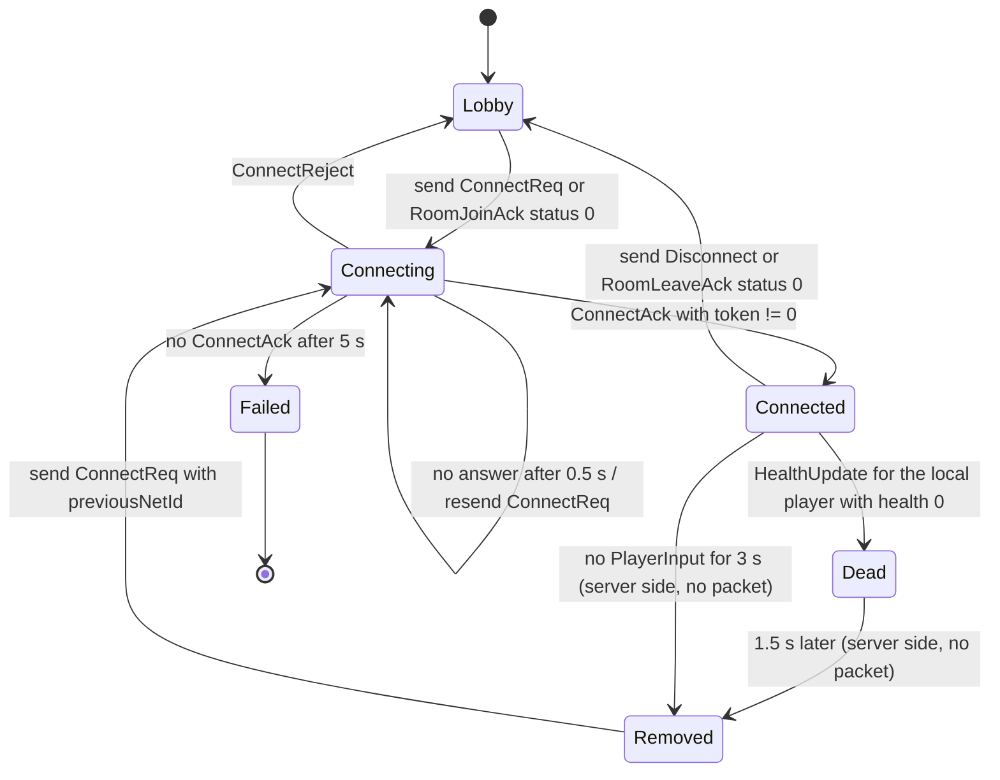
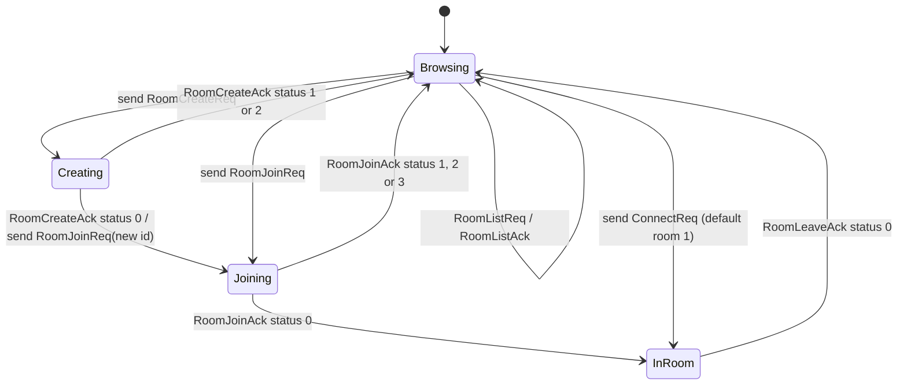
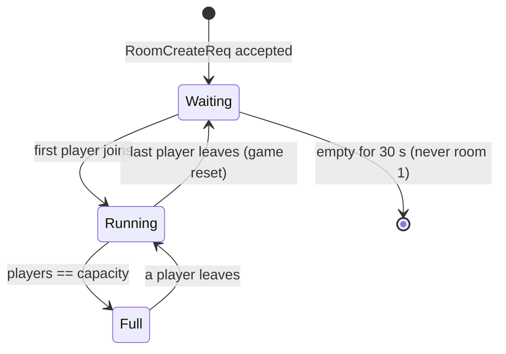
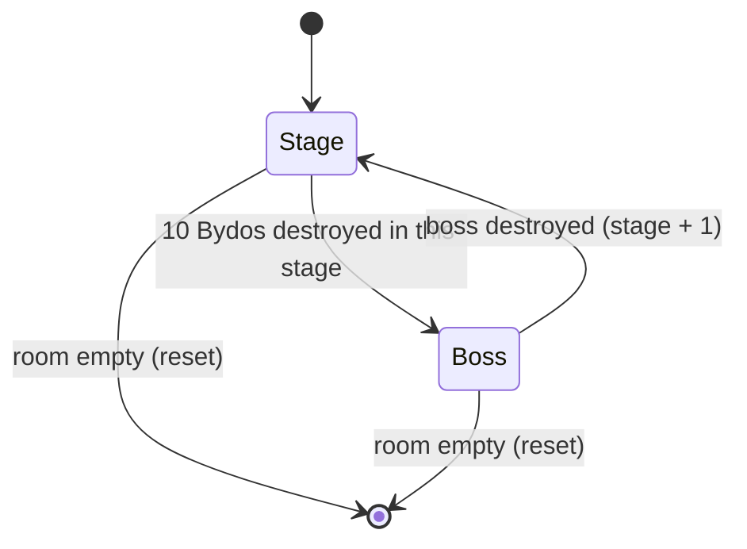

# R-Type network protocol reference

This document is the reference for the R-Type binary protocol. It is meant to
be complete enough to write an independent client without reading the
project's source code.

Source of truth in the code:

- [Protocol.hpp](../include/common/network/Protocol.hpp): packet types, header, entity state structs.
- [PacketStream.hpp](../include/common/network/PacketStream.hpp): byte encoding of every field.
- [ServerNetworkManager.hpp](../include/server/ServerNetworkManager.hpp): server-side dispatch and validation.
- [ReliableUdpQueue.hpp](../include/server/ReliableUdpQueue.hpp): reliable delivery.
- [ClientNetworkManager.hpp](../include/client/network/ClientNetworkManager.hpp): reference client.

The rationale behind gameplay packets is described in
[protocol-extension.md](protocol-extension.md).

## Contents

1. [Transport](#1-transport)
2. [Encoding conventions](#2-encoding-conventions)
3. [Packet header](#3-packet-header)
4. [Packet types](#4-packet-types)
5. [Connection packets](#5-connection-packets)
6. [Lobby and room packets](#6-lobby-and-room-packets)
7. [Gameplay event packets](#7-gameplay-event-packets)
8. [Inputs and snapshots](#8-inputs-and-snapshots)
9. [Ack, Ping and Pong](#9-ack-ping-and-pong)
10. [States and transitions](#10-states-and-transitions)
11. [Sequencing, reliability, timeouts and errors](#11-sequencing-reliability-timeouts-and-errors)
12. [Size limits and rejection rules](#12-size-limits-and-rejection-rules)
13. [Packet examples](#13-packet-examples)

## 1. Transport

- All traffic uses **UDP**. One datagram carries exactly one packet.
- The server listens on a single UDP port. The client sends from any port and
  only accepts packets coming from the server's port.
- There is no TCP channel, no encryption and no compression layer.
- Packets that need guaranteed delivery are acknowledged and retransmitted at
  the application level (see [section 11](#11-sequencing-reliability-timeouts-and-errors)).

## 2. Encoding conventions

| Type | Size | Encoding |
| --- | --- | --- |
| `u8` | 1 byte | Unsigned integer |
| `u16` | 2 bytes | Unsigned integer, **little-endian** |
| `u32` | 4 bytes | Unsigned integer, **little-endian** |
| `u64` | 8 bytes | Unsigned integer, **little-endian** |
| `i16` | 2 bytes | Two's complement signed integer, **little-endian** |
| `f32` | 4 bytes | IEEE-754 single precision, its 32 bits sent as a little-endian `u32` |
| `bool` | 1 byte | `0x00` = false, `0x01` = true. Any other value makes the packet invalid. |
| `NetworkId` | 4 bytes | Alias of `u32` |

Rules:

- **Byte order is little-endian on the wire**, whatever the host. The
  reference implementation writes and reads integers byte by byte, so it does
  not depend on the machine's byte order. An implementation running on a
  big-endian host must convert every multi-byte field.
- Fields are packed one after another, in the order given by each table.
  There is **no padding and no alignment**.
- Sizes in this document are always in bytes.
- A packet whose payload is shorter than its fields require is invalid and is
  dropped (see [section 12](#12-size-limits-and-rejection-rules)).

## 3. Packet header

Every packet starts with a fixed **9-byte** header, followed by
`payloadSize` bytes of payload.

| Offset | Field | Type | Description |
| --- | --- | --- | --- |
| 0 | `magic` | `u16` | Always `0x5254`. On the wire: `54 52`. |
| 2 | `type` | `u8` | Packet type, see [section 4](#4-packet-types). |
| 3 | `sequence` | `u32` | Sender's sequence number, see [section 11](#11-sequencing-reliability-timeouts-and-errors). |
| 7 | `payloadSize` | `u16` | Number of payload bytes after the header. |

A receiver must drop the datagram if:

- it is shorter than 9 bytes;
- `magic` is not `0x5254`;
- `payloadSize` is not exactly `datagram size - 9`.

Example: header of a `ConnectReq` (`0x01`) with sequence `1` and an empty payload:

```text
54 52  01  01 00 00 00  00 00
magic  type sequence    payloadSize
```

## 4. Packet types

Direction: **C → S** = client to server, **S → C** = server to client.
Reliable: the receiver must answer with an `Ack`, and the sender retransmits
until it gets one (see [section 11](#11-sequencing-reliability-timeouts-and-errors)).

| Id | Name | Direction | Reliable | Payload size | Details |
| --- | --- | --- | --- | --- | --- |
| `0x01` | `ConnectReq` | C → S | no (client retries) | 0, 1, 2 or 6 | [5](#5-connection-packets) |
| `0x02` | `ConnectAck` | S → C | yes | 13 | [5](#5-connection-packets) |
| `0x03` | `Disconnect` | C → S | no | 12 | [5](#5-connection-packets) |
| `0x04` | `ConnectReject` | S → C | yes | 1 | [5](#5-connection-packets) |
| `0x05` | `Ack` | C → S | no | 4 | [9](#9-ack-ping-and-pong) |
| `0x10` | `SpawnPlayer` | S → C | yes | 13 | [7](#7-gameplay-event-packets) |
| `0x11` | `DestroyEntity` | S → C | yes | 4 | [7](#7-gameplay-event-packets) |
| `0x12` | `SpawnEntity` | S → C | yes | 13 | [7](#7-gameplay-event-packets) |
| `0x13` | `HealthUpdate` | S → C | yes | 6 | [7](#7-gameplay-event-packets) |
| `0x14` | `AugmentUpdate` | S → C | yes | 10 | [7](#7-gameplay-event-packets) |
| `0x15` | `ScoreUpdate` | S → C | yes | 8 | [7](#7-gameplay-event-packets) |
| `0x20` | `PlayerInput` | C → S | no | 17 | [8](#8-inputs-and-snapshots) |
| `0x30` | `GameStateSync` | S → C | no | 2 + 20 × count | [8](#8-inputs-and-snapshots) (legacy, not sent by the current server) |
| `0x31` | `GameStateSyncPacked` | S → C | no | 6 + 12 × count | [8](#8-inputs-and-snapshots) |
| `0x32` | `GameStateSyncDelta` | S → C | no | 12 or more | [8](#8-inputs-and-snapshots) |
| `0x33` | `InputAck` | S → C | no | 16 | [8](#8-inputs-and-snapshots) |
| `0x34` | `SnapshotRequest` | C → S | no | 12 | [8](#8-inputs-and-snapshots) |
| `0x40` | `RoomListReq` | C → S | no | 0 | [6](#6-lobby-and-room-packets) |
| `0x41` | `RoomListAck` | S → C | yes | 2 + 8 × count | [6](#6-lobby-and-room-packets) |
| `0x42` | `RoomCreateReq` | C → S | no | 2 | [6](#6-lobby-and-room-packets) |
| `0x43` | `RoomCreateAck` | S → C | yes | 5 | [6](#6-lobby-and-room-packets) |
| `0x44` | `RoomJoinReq` | C → S | no | 10 | [6](#6-lobby-and-room-packets) |
| `0x45` | `RoomJoinAck` | S → C | yes | 5 | [6](#6-lobby-and-room-packets) |
| `0x46` | `RoomLeaveReq` | C → S | no | 12 | [6](#6-lobby-and-room-packets) |
| `0x47` | `RoomLeaveAck` | S → C | yes | 5 | [6](#6-lobby-and-room-packets) |
| `0xE0` | `Ping` | C → S | no | 8 | [9](#9-ack-ping-and-pong) |
| `0xE1` | `Pong` | S → C | no | 8 | [9](#9-ack-ping-and-pong) |

Any other type id is unknown: the server counts it as rejected and ignores
it. A client should ignore unknown types too.

## 5. Connection packets

A client joins a game with `ConnectReq`. The server answers with `ConnectAck`,
which gives the client its player id and a **session token**. Every later
packet that acts on the player (`PlayerInput`, `Disconnect`,
`SnapshotRequest`, `RoomLeaveReq`) must carry both values, and must come from
the same address and port as the `ConnectReq`.

### `ConnectReq` (`0x01`, C → S)

| Offset | Field | Type | Description |
| --- | --- | --- | --- |
| 0 | `difficulty` | `u8` | `0` = easy, `1` = normal, `2` = hard, `0xFF` = no preference. |
| 1 | `skin` | `u8` | Ship skin index, `0xFF` = no preference. |
| 2 | `previousNetId` | `u32` | Player id from a previous game, to keep the same player number. |

The payload is **0, 1, 2 or 6 bytes** long. A field is only present if all
the fields before it are present: to send only `skin`, send
`difficulty = 0xFF` first. Any other payload size is dropped.

Server rules:

- `difficulty` above `2` (other than `0xFF`) is treated as `1`. `0xFF` means `1`.
- The first player of a room chooses the difficulty. Later players get the
  room's current difficulty, whatever they ask for. Rooms created with a
  fixed difficulty ignore the field (see [section 6](#6-lobby-and-room-packets)).
- `previousNetId` is used only if it is in the range `1000`–`1999` and no
  other player of the room uses it. Otherwise the server picks a free id.
- If the sender's address and port are already in a room, the server does not
  create a new player: it sends the same `ConnectAck` again (same id, same
  token) and resends the current world. This makes `ConnectReq` safe to repeat.
- If the sender is not in any room, the request goes to the **default room**.
  If that room is full, the server answers `ConnectReject` with reason `1`.

`ConnectReq` is not acknowledged. The client retries it itself (see
[section 11](#11-sequencing-reliability-timeouts-and-errors)).

### `ConnectAck` (`0x02`, S → C, reliable)

| Offset | Field | Type | Description |
| --- | --- | --- | --- |
| 0 | `netId` | `NetworkId` | Id of the local player, in `1000`–`1999`. |
| 4 | `difficulty` | `u8` | Difficulty actually used by the room: `0`, `1` or `2`. |
| 5 | `sessionToken` | `u64` | Random secret for this player. Never `0`. |

Payload: **13 bytes**.

The client is connected once it has received a `ConnectAck` with a non-zero
token. Right after the `ConnectAck`, the server sends to the new client, in
this order:

1. `SpawnPlayer` + `HealthUpdate` for the new player;
2. `SpawnPlayer` + `HealthUpdate` for every other player of the room;
3. `SpawnPlayer` + `HealthUpdate` for the new player **again** (the server
   announces the new player to every member of the room, the new player
   included);
4. `ScoreUpdate` and active `AugmentUpdate` for every player, then the new
   player's `ScoreUpdate` **again**;
5. `SpawnEntity` (+ `HealthUpdate` for entities with more than 1 HP) for every
   entity already in the game.

The repeated packets of steps 3 and 4 carry **new** sequence numbers, so the
duplicate detection of [section 11](#11-sequencing-reliability-timeouts-and-errors)
does not catch them. A client must handle them as normal packets: a second
`SpawnPlayer` for an id it already knows is ignored, and a `HealthUpdate` or
`ScoreUpdate` with the same values changes nothing.

The other players of the room receive `SpawnPlayer`, `HealthUpdate` and
`ScoreUpdate` for the new player.

Because these packets travel over UDP, they can arrive **before** the
`ConnectAck`. A client should keep a `SpawnPlayer` received before the
`ConnectAck` and apply it once connected (the reference client keeps up to 4).

### `ConnectReject` (`0x04`, S → C, reliable)

| Offset | Field | Type | Description |
| --- | --- | --- | --- |
| 0 | `reason` | `u8` | Why the connection was refused. |

Payload: **1 byte**.

| Reason | Meaning |
| --- | --- |
| `1` | The default room is full. |

After a `ConnectReject` the client must stop retrying its `ConnectReq`.

### `Disconnect` (`0x03`, C → S)

| Offset | Field | Type | Description |
| --- | --- | --- | --- |
| 0 | `netId` | `NetworkId` | Id received in `ConnectAck`. |
| 4 | `sessionToken` | `u64` | Token received in `ConnectAck`. |

Payload: **12 bytes**.

- The server checks that the id exists, that the token matches and that the
  packet comes from the player's address and port. Otherwise it ignores the
  packet.
- On success, the player is removed, its missiles are destroyed, pending
  reliable packets for its address are cancelled, and the other players
  receive a `DestroyEntity` with the player's id.
- The server does **not** answer the leaving client. `Disconnect` is not
  acknowledged, so it can be lost; in that case the player is removed by the
  inactivity timeout below.

### Inactivity timeout

The server removes a player that has sent no valid `PlayerInput` for
**3 seconds**, exactly as if it had sent a `Disconnect`. A connected client
must therefore keep sending `PlayerInput` packets, even when the player is
not moving (all buttons set to false) or dead (until it is removed, see
[section 10](#10-states-and-transitions)).

## 6. Lobby and room packets

One server hosts several independent games called **rooms**. Each room has
its own players, entities and score.

- **Room `1` is the default room.** It always exists and is never deleted.
  A plain `ConnectReq` puts the player there. Its difficulty is chosen by its
  first player.
- Other rooms are created with `RoomCreateReq`. Their ids start at `2`, their
  difficulty is fixed at creation, and they are deleted after staying empty
  for **30 seconds**.
- A room holds at most **4** players. The server holds at most **16** rooms,
  the default room included. The server options `--room-capacity` (1 to 4)
  and `--max-rooms` (1 to 128) change these values.
- A client address and port can be in only one room at a time.

Every `*Ack` of this section is reliable. The requests are not: if no answer
comes, the client sends the request again. All requests can be repeated
safely (see each packet).

### `RoomListReq` (`0x40`, C → S)

Empty payload (**0 bytes**). Any other size is dropped.

### `RoomListAck` (`0x41`, S → C, reliable)

| Offset | Field | Type | Description |
| --- | --- | --- | --- |
| 0 | `count` | `u16` | Number of rooms that follow. |
| 2 | `rooms` | `count` × room entry | Sorted by room id, smallest first. |

Room entry (**8 bytes**):

| Offset | Field | Type | Description |
| --- | --- | --- | --- |
| 0 | `roomId` | `u32` | Room id. |
| 4 | `players` | `u8` | Players currently in the room. |
| 5 | `capacity` | `u8` | Maximum number of players. |
| 6 | `state` | `u8` | `0` = waiting (empty), `1` = running, `2` = full. |
| 7 | `difficulty` | `u8` | `0` = easy, `1` = normal, `2` = hard. |

Payload: **2 + 8 × `count` bytes**.

### `RoomCreateReq` (`0x42`, C → S)

| Offset | Field | Type | Description |
| --- | --- | --- | --- |
| 0 | `capacity` | `u8` | Maximum players, `1` to `4`. |
| 1 | `difficulty` | `u8` | `0`, `1` or `2`. `0xFF` is **not** accepted here. |

Payload: **2 bytes**. Any other size is dropped.

Creating a room does **not** join it: the client must then send a
`RoomJoinReq` with the new room id. If the same client sends
`RoomCreateReq` again before joining, the server answers with the room it
already created instead of creating a second one.

### `RoomJoinReq` (`0x44`, C → S)

| Offset | Field | Type | Description |
| --- | --- | --- | --- |
| 0 | `roomId` | `u32` | Room to join. |
| 4 | `difficulty` | `u8` | Same meaning as in `ConnectReq`. Ignored by rooms with a fixed difficulty. |
| 5 | `skin` | `u8` | Same meaning as in `ConnectReq`. |
| 6 | `previousNetId` | `u32` | Same meaning as in `ConnectReq`, `0` if none. |

Payload: **10 bytes**. Any other size is dropped.

When the answer is a success, the server joins the room **for** the client,
as if it had received a `ConnectReq` with the same fields. The client must
not send a `ConnectReq` itself: it receives the `RoomJoinAck`, then the
`ConnectAck` and the world, exactly as described in
[section 5](#5-connection-packets). Joining a room the client is already in
answers success again and resends the `ConnectAck` and the world.

### `RoomLeaveReq` (`0x46`, C → S)

| Offset | Field | Type | Description |
| --- | --- | --- | --- |
| 0 | `netId` | `NetworkId` | Id received in `ConnectAck`. |
| 4 | `sessionToken` | `u64` | Token received in `ConnectAck`. |

Payload: **12 bytes**. Any other size is dropped.

On success, the player leaves the room exactly as with `Disconnect`, and the
server answers `RoomLeaveAck`. For **10 seconds** after a successful leave,
the same request (same address, port, id and token) gets the same success
answer again, so a lost `RoomLeaveAck` can be recovered by repeating the
request.

### `RoomCreateAck`, `RoomJoinAck`, `RoomLeaveAck` (`0x43`, `0x45`, `0x47`, S → C, reliable)

The three answers share the same format:

| Offset | Field | Type | Description |
| --- | --- | --- | --- |
| 0 | `roomId` | `u32` | Room concerned, or `0` when no room applies. |
| 4 | `status` | `u8` | `0` = success, other values below. |

Payload: **5 bytes**.

| Packet | Status | Meaning | `roomId` |
| --- | --- | --- | --- |
| `RoomCreateAck` | `0` | Room created. | New room id |
| `RoomCreateAck` | `1` | Invalid `capacity` or `difficulty`, or the client is already in a room. | `0` |
| `RoomCreateAck` | `2` | Room limit reached. | `0` |
| `RoomJoinAck` | `0` | Joined (or already in this room). | Requested id |
| `RoomJoinAck` | `1` | No room with this id. | Requested id |
| `RoomJoinAck` | `2` | Room full. | Requested id |
| `RoomJoinAck` | `3` | The client is already in another room. It must leave first. | Requested id |
| `RoomLeaveAck` | `0` | Left the room. | Room left |
| `RoomLeaveAck` | `1` | Not in a room, or wrong id or token. | Current room, or `0` |

## 7. Gameplay event packets

These packets tell the client what exists in the game. Positions are moved
afterwards by snapshots (see [section 8](#8-inputs-and-snapshots)).
All of them are **reliable**.

Conventions:

- Positions are `f32` in pixels, in a **1920 × 1080** world, with the origin
  at the top-left corner and Y going down.
- Player ids are in `1000`–`1999`. Other entities use ids from `2000`.
  Ids can be reused after an entity is destroyed.
- UDP can deliver an event about an entity before its `SpawnPlayer` or
  `SpawnEntity`. A client should keep, for a short time, events about an id
  it does not know yet, and apply them once the entity is spawned.

### `SpawnPlayer` (`0x10`, S → C, reliable)

| Offset | Field | Type | Description |
| --- | --- | --- | --- |
| 0 | `netId` | `NetworkId` | Player id. If it equals the id from `ConnectAck`, this is the local player. |
| 4 | `posX` | `f32` | Start position. |
| 8 | `posY` | `f32` | Start position. |
| 12 | `skin` | `u8` | Ship skin index, `0xFF` = none. |

Payload: **13 bytes**. Sent when a player joins a room, to every player of
that room.

### `SpawnEntity` (`0x12`, S → C, reliable)

| Offset | Field | Type | Description |
| --- | --- | --- | --- |
| 0 | `netId` | `NetworkId` | Entity id. |
| 4 | `type` | `u8` | Entity type, see the table below. |
| 5 | `posX` | `f32` | Start position. |
| 9 | `posY` | `f32` | Start position. |

Payload: **13 bytes**.

| Type | Entity |
| --- | --- |
| `0` | Player. Reserved: players are always announced by `SpawnPlayer`. |
| `1` | Bydos (regular enemy). |
| `2` | Player missile. |
| `3` | Enemy missile. Also used for the boss shots. |
| `4` | Bonus: double shot. |
| `5` | Bonus: triple shot. |
| `6` | Bonus: heal. |
| `7` | Bonus: damage up. |
| `8` | Player missile with damage up (bigger sprite). |
| `9` | Stage boss. |

The reference client also defines type `10` (boss shot) in its configuration,
but the current server never sends it. A client should ignore unknown types.

### `DestroyEntity` (`0x11`, S → C, reliable)

| Offset | Field | Type | Description |
| --- | --- | --- | --- |
| 0 | `netId` | `NetworkId` | Id of the player or entity to remove. |

Payload: **4 bytes**. Sent when an entity dies, is collected or leaves the
screen, and when a player leaves the room (`Disconnect`, `RoomLeaveReq` or
timeout), to the players that stay in the room. A player whose health
reaches `0` stays in the room for **1.5 seconds**, then is removed like a
player that left (see [section 10](#10-states-and-transitions)). The removed
player itself does not receive this `DestroyEntity`.

### `HealthUpdate` (`0x13`, S → C, reliable)

| Offset | Field | Type | Description |
| --- | --- | --- | --- |
| 0 | `netId` | `NetworkId` | Player or entity. |
| 4 | `health` | `u8` | Current health. `0` = dead. |
| 5 | `maxHealth` | `u8` | Maximum health. |

Payload: **6 bytes**. Sent for every player when it joins and when its health
changes, and for entities with more than 1 HP (the boss, stronger Bydos).
Players start with 8 HP in easy, 5 in normal and 4 in hard.

### `AugmentUpdate` (`0x14`, S → C, reliable)

| Offset | Field | Type | Description |
| --- | --- | --- | --- |
| 0 | `netId` | `NetworkId` | Player who has the augment. |
| 4 | `augment` | `u8` | Augment id, see below. |
| 5 | `level` | `u8` | Stack level. `1` for augments that do not stack, `0` when the augment ended. |
| 6 | `remaining` | `f32` | Seconds left. `0` = the augment ended. |

Payload: **10 bytes**. Sent to every player of the room when a player gains,
refreshes or loses an augment, and to a joining client for every active
augment. The current server always sends `remaining >= 0`; a client should
treat a negative value as "permanent".

| Augment | Meaning | Levels |
| --- | --- | --- |
| `1` | Double shot | 1 |
| `2` | Triple shot (replaces double shot) | 1 |
| `3` | Damage up | 1 to 2 |

### `ScoreUpdate` (`0x15`, S → C, reliable)

| Offset | Field | Type | Description |
| --- | --- | --- | --- |
| 0 | `netId` | `NetworkId` | Player whose score changed. |
| 4 | `score` | `u32` | New **total** score of that player (not a difference). |

Payload: **8 bytes**. Sent to every player of the room when a score changes,
and to a joining client for every player.

### Event ordering

Each event carries the server's `sequence` number. Because a retransmitted
event can arrive after a newer one, a client should apply a `HealthUpdate`,
`AugmentUpdate` or `ScoreUpdate` only if its `sequence` is newer than the last
one applied for the same player (and, for augments, the same augment id).
In the same way, because ids are reused, a `SpawnPlayer` or `SpawnEntity`
whose `sequence` is older than the `DestroyEntity` already received for the
same id must be ignored: it is a late copy of the previous entity.
See [section 11](#11-sequencing-reliability-timeouts-and-errors) for how to
compare sequence numbers.

## 8. Inputs and snapshots

The server is **authoritative**: the client only sends button states, and
the server computes every position. The server simulates the game at a
fixed **60 ticks per second**.

None of the packets in this section is reliable. A lost input is replaced by
the next one, and a lost snapshot by the next snapshot.

### `PlayerInput` (`0x20`, C → S)

| Offset | Field | Type | Description |
| --- | --- | --- | --- |
| 0 | `netId` | `NetworkId` | Id received in `ConnectAck`. |
| 4 | `sessionToken` | `u64` | Token received in `ConnectAck`. |
| 12 | `up` | `bool` | Button held. |
| 13 | `down` | `bool` | Button held. |
| 14 | `left` | `bool` | Button held. |
| 15 | `right` | `bool` | Button held. |
| 16 | `shoot` | `bool` | Button held. |

Payload: **17 bytes**. Any other size is dropped.

**The header `sequence` is the input number.** It must increase with every
`PlayerInput` (the reference client uses one counter for every packet it
sends, so input numbers can skip values; that is allowed).

Each `PlayerInput` stands for **one simulation step of 1/60 s**. A client
should send exactly 60 inputs per second, at a fixed rate, even when no
button is held and even when the player is dead. The reference client sends
at most 4 inputs in one frame to catch up after a slow frame.

Server rules:

- The packet is dropped if a `bool` is not `0` or `1`, if the id or token is
  wrong, if it does not come from the player's address and port, or if its
  `sequence` is not newer than the last accepted input.
- Accepted inputs are queued. The queue holds **8** inputs; when it is full,
  the oldest one is dropped. The server applies **up to 2** queued inputs per
  tick.
- Each applied input moves the player for 1/60 s at **300 px/s** (diagonals
  are normalized to the same speed). The position is clamped to
  `0 ≤ x ≤ 1887` and `0 ≤ y ≤ 1046` (world size minus the 33 × 34 ship).
- `shoot` fires a missile at most every **0.25 s** while held.
- While the player is dead, inputs are discarded but still acknowledged.

### `InputAck` (`0x33`, S → C)

| Offset | Field | Type | Description |
| --- | --- | --- | --- |
| 0 | `lastInput` | `u32` | `sequence` of the last `PlayerInput` applied (or discarded). |
| 4 | `tick` | `u32` | Server simulation tick when the ack was sent. |
| 8 | `posX` | `f32` | Player position after applying `lastInput`. |
| 12 | `posY` | `f32` | Player position after applying `lastInput`. |

Payload: **16 bytes**. Sent to each player after each pass of the server
main loop, right before the snapshot (even when no delta is sent), once the
server has applied at least one of its inputs.

A client that predicts its own movement uses it to correct itself: drop the
saved inputs up to `lastInput`, start again from (`posX`, `posY`) and replay
the inputs that are not acknowledged yet. An `InputAck` whose `lastInput` is
not newer than the previous one must be ignored. Prediction must use the
same movement rules as the server (speed, step and bounds above).

### Snapshots

A snapshot gives the position and velocity of **every player and entity**
of the room. The server sends one after each pass of its main loop (about
60 per second), in one of two formats:

- **`GameStateSyncPacked`**: a full snapshot. Sent as the first snapshot to
  every new client, then to everybody every **60** snapshots (about once per second), and to a client that
  asked for one with `SnapshotRequest`.
- **`GameStateSyncDelta`**: only what changed since the **previous snapshot
  sent by the server**. If nothing changed, no delta is sent.

Both formats use the same entity state, with positions and velocities
stored as `i16` instead of `f32`:

#### Packed entity state (12 bytes)

| Offset | Field | Type | Decoding |
| --- | --- | --- | --- |
| 0 | `netId` | `NetworkId` | Player or entity id. |
| 4 | `posX` | `i16` | `posX / 8` pixels. |
| 6 | `posY` | `i16` | `posY / 8` pixels. |
| 8 | `velX` | `i16` | `velX / 4` pixels per second. |
| 10 | `velY` | `i16` | `velY / 4` pixels per second. |

Encoding: `round(value × 8)` for positions and `round(value × 4)` for
velocities, clamped to `-32768`…`32767`. Non-finite values are sent as `0`.
Precision is 0.125 px for positions and 0.25 px/s for velocities.

#### Snapshot ticks

Every snapshot carries a `tick`: the server simulation tick when it was
built. Ticks count 60 per second and restart at `0` when the room becomes
empty. A snapshot whose `tick` is not newer than the last one applied is old
(it was delayed by the network): use it for interpolation history only, not
as the current state.

Entities are created and destroyed by the event packets of
[section 7](#7-gameplay-event-packets). A snapshot only updates the state
of entities the client knows; a `netId` that has not been spawned yet can be
ignored or kept until its `SpawnEntity` arrives.

### `GameStateSyncPacked` (`0x31`, S → C)

| Offset | Field | Type | Description |
| --- | --- | --- | --- |
| 0 | `tick` | `u32` | Snapshot tick. |
| 4 | `count` | `u16` | Number of entity states. |
| 6 | `entities` | `count` × packed entity state | Every player and entity, in no particular order. |

Payload: **6 + 12 × `count` bytes**. The reference client drops the packet
if `count` is above 256 or if the payload size does not match `count`.

### `GameStateSyncDelta` (`0x32`, S → C)

| Field | Type | Description |
| --- | --- | --- |
| `tick` | `u32` | Tick of the snapshot this delta builds. |
| `baseTick` | `u32` | Tick of the snapshot the delta applies to. |
| `changedCount` | `u16` | Number of changed records. |
| `changed` | `changedCount` × changed record | See below. |
| `removedCount` | `u16` | Number of removed ids. |
| `removed` | `removedCount` × `NetworkId` | Ids that are no longer in the snapshot. |

Changed record (**5 to 13 bytes**):

| Field | Type | Present if |
| --- | --- | --- |
| `netId` | `NetworkId` | always |
| `mask` | `u8` | always |
| `posX` | `i16` | `mask & 0x01` |
| `posY` | `i16` | `mask & 0x02` |
| `velX` | `i16` | `mask & 0x04` |
| `velY` | `i16` | `mask & 0x08` |

Payload: **12 + size of the changed records + 4 × `removedCount` bytes**.
The smallest delta (nothing changed, nothing removed) is 12 bytes.

To rebuild the snapshot `tick`:

1. Find the snapshot `baseTick` that the client already rebuilt. The client
   must therefore **keep the last snapshots** (the reference client keeps 64).
2. Copy it, remove the `removed` ids, then for each changed record copy the
   fields given by `mask`.
3. A `netId` that is not in the base snapshot is a new entity: its record
   must have `mask = 0x0F` (all fields).
4. Store the result under `tick`. If a snapshot with this `tick` already
   exists, ignore the delta.

The delta is invalid, and must be dropped, if `changedCount` or
`removedCount` is above 256, if a `mask` is `0` or has bits other than
`0x0F`, if a new entity has a partial `mask`, or if bytes remain after the
`removed` list.

**If the base snapshot is missing** (a snapshot was lost), keep the delta for
a short time, because the base may still arrive. The reference client waits
**100 ms** and keeps at most **16** waiting deltas. Then it sends a
`SnapshotRequest` and waits for the next `GameStateSyncPacked`.

### `SnapshotRequest` (`0x34`, C → S)

| Offset | Field | Type | Description |
| --- | --- | --- | --- |
| 0 | `netId` | `NetworkId` | Id received in `ConnectAck`. |
| 4 | `sessionToken` | `u64` | Token received in `ConnectAck`. |

Payload: **12 bytes**. Any other size, wrong id or token, or a packet from
another address is dropped.

The next snapshot sent to this client is a `GameStateSyncPacked`. The request
is not acknowledged: if no full snapshot arrives, send it again. The
reference client sends at most one request every **250 ms**.

### `GameStateSync` (`0x30`, S → C, legacy)

| Offset | Field | Type | Description |
| --- | --- | --- | --- |
| 0 | `count` | `u16` | Number of entity states. |
| 2 | `entities` | `count` × entity state | See below. |

Entity state (**20 bytes**): `netId` (`NetworkId`), `posX`, `posY`, `velX`,
`velY` (`f32` each).

Payload: **2 + 20 × `count` bytes**. This is the first snapshot format, with
no tick. The current server never sends it; the reference client still reads
it and ignores it if its header `sequence` is not newer than the last one.

## 9. Ack, Ping and Pong

### `Ack` (`0x05`, C → S)

| Offset | Field | Type | Description |
| --- | --- | --- | --- |
| 0 | `sequence` | `u32` | Header `sequence` of the reliable packet being acknowledged. |

Payload: **4 bytes**. Any other size is dropped.

- The client must send one `Ack` for **every** reliable packet it receives
  (the 12 packets marked "yes" in [section 4](#4-packet-types)), **including
  duplicates**: a duplicate means the previous `Ack` was lost.
- The server then stops retransmitting that packet to this address.
- Only the client sends `Ack`. Packets sent by the client are never
  acknowledged by the server.

Full rules are in [section 11](#11-sequencing-reliability-timeouts-and-errors).

### `Ping` (`0xE0`, C → S)

| Offset | Field | Type | Description |
| --- | --- | --- | --- |
| 0 | `timestamp` | `u64` | Any value chosen by the client, usually its send time. |

Payload: **8 bytes**. Any other size is dropped.

The server does not read `timestamp`: it copies it into a `Pong`. A `Ping`
does not need a connection, so it also works before `ConnectReq` (for
example to measure latency in a server list). The reference client sends
one `Ping` every 0.5 s in the lobby and in game, to measure the round-trip time,
the jitter and the loss ([network-metrics.md](network-metrics.md)).

### `Pong` (`0xE1`, S → C)

| Offset | Field | Type | Description |
| --- | --- | --- | --- |
| 0 | `timestamp` | `u64` | Same value as in the `Ping`. |

Payload: **8 bytes**. The round-trip time is "time when the `Pong` arrives
minus `timestamp`", if `timestamp` was the send time. `Pong` is not
reliable: a `Ping` without answer can be counted as lost.

## 10. States and transitions

The server does not send its state machines: a client follows them from
the packets it sends and receives. Each diagram gives the packet or the
timer that causes every transition.

### Client connection



| State | What the client sends | What it must accept |
| --- | --- | --- |
| Lobby | `RoomListReq`, `RoomCreateReq`, `RoomJoinReq`, `ConnectReq`, `Ping` | `RoomListAck`, `Room*Ack`, `Pong` |
| Connecting | `ConnectReq` (retries), `Ack` | `ConnectAck`, `ConnectReject`, and early `SpawnPlayer` / events to keep for later |
| Connected | `PlayerInput` 60 times per second, `Ack`, `SnapshotRequest`, `Disconnect`, `RoomLeaveReq` | every server packet |
| Dead | Same as Connected (inputs are discarded by the server) | every server packet |
| Removed | Nothing valid: inputs are rejected | nothing, until a new `ConnectReq` |

Notes:

- The server never tells a client it was removed. A dead client knows it from
  its own `HealthUpdate` with `health = 0`; the reference client then shows
  "DESTROYED" and offers to go back to the lobby, sending a `RoomLeaveReq`.
- To play again, send a new `ConnectReq` (or `RoomJoinReq`) from the same
  socket with `previousNetId` set to the old id: the player gets the same
  number back if it is still free.
- The 5-second connection timeout is a client choice (`connect_timeout` in
  `client.cfg`). The reference client stops resending `ConnectReq` (or
  `RoomJoinReq`) after 8 retries, about 4.5 seconds after the first send, and
  goes back to its lobby with a "no answer" message.
- The reference client leaves its room as soon as it sends `RoomLeaveReq`: it
  destroys every remote entity and forgets the session (id, token, received
  sequence numbers, snapshots) without waiting for `RoomLeaveAck`.

### Lobby



`InRoom` is the `Connecting` / `Connected` part of the client connection
diagram above.

### Room



The state is the `state` field of `RoomListAck`: `0` = Waiting, `1` =
Running, `2` = Full. A new room starts its 30-second timer at creation, so a
room nobody joins is deleted 30 seconds later.

When the last player leaves, the game is **reset**: entities are cleared,
the stage goes back to 1, entity ids restart at `2000`, and snapshot ticks
restart at `0`.

### Game



| Phase | What the client sees |
| --- | --- |
| Stage | `SpawnEntity` of Bydos (type `1`), enemy missiles (type `3`) and bonuses (types `4` to `7`). |
| Boss | `DestroyEntity` for the remaining Bydos, then `SpawnEntity` of type `9` and its `HealthUpdate`. |
| Boss destroyed | `DestroyEntity` of the boss and a `ScoreUpdate` (+1000) for the player whose missile destroyed it. |

### Player inside a game

| Event | Packets |
| --- | --- |
| Hit by an enemy or a missile | `HealthUpdate` to every player of the room. |
| Health reaches `0` | `HealthUpdate` with `health = 0`, `AugmentUpdate` with `level = 0` and `remaining = 0` for each active augment. |
| 1.5 s after death | Player removed: `DestroyEntity` to the other players. |

## 11. Sequencing, reliability, timeouts and errors

### The `sequence` field

- **Server packets**: one counter shared by **all rooms and all clients**,
  starting at `1` and increased for every packet built. A packet sent to
  several players (a broadcast) has the same `sequence` for all of them.
  A client therefore sees **gaps** in the sequence numbers: a gap does
  **not** mean that a packet was lost.
- **Client packets**: each client has its own counter. The reference client
  uses one counter for every packet it sends (`ConnectReq`, `PlayerInput`,
  `Ack`, ...). Only `PlayerInput` gives the number a meaning: the input number
  (see [section 8](#8-inputs-and-snapshots)).
- Sequence numbers are 32 bits and **wrap around**. Compare them with
  "serial number arithmetic":

```text
isNewer(a, b) = (a - b) mod 2^32 is between 1 and 2^31 - 1
```

The server uses this rule for `PlayerInput`. The reference client uses it
for snapshots, `InputAck` (`lastInput`) and per-entity events.

### Reliable packets

These 12 server packets are reliable: `ConnectAck`, `ConnectReject`,
`RoomListAck`, `RoomCreateAck`, `RoomJoinAck`, `RoomLeaveAck`,
`SpawnPlayer`, `DestroyEntity`, `SpawnEntity`, `HealthUpdate`,
`AugmentUpdate`, `ScoreUpdate`.

**Server side (sender):**

1. The packet is sent and kept in a retransmission queue, by
   (address, port, `sequence`).
2. When an `Ack` with the same `sequence` comes from that address and port,
   the packet is removed from the queue.
3. Otherwise it is sent again, with the same bytes and the same `sequence`.
   The first wait is **150 ms** and it doubles after each retry, up to
   **1.2 s**: retries at about 0.15 s, 0.45 s, 1.05 s, 2.25 s and 3.45 s
   after the first send.
4. After **5 retries** without an `Ack` (about 4.65 s), the packet is
   dropped for good. The server does not disconnect the player for this.
5. When a player leaves or is removed, every packet waiting for its address
   is dropped.

**Client side (receiver):**

1. For every reliable packet that passes the header checks, send an `Ack`
   with its `sequence`, **even if it is a duplicate**.
2. Then drop the packet if its `sequence` was already received. The reference
   client remembers the last **512** reliable sequence numbers.
3. Reliable does not mean ordered. Use the rules of
   [section 7](#7-gameplay-event-packets) for events that arrive in the
   wrong order.

### Client requests

Client packets are never acknowledged. A client that needs an answer
repeats the request itself. Every request can be repeated safely:

| Request | Answer that stops the retries | Reference client |
| --- | --- | --- |
| `ConnectReq` | `ConnectAck` or `ConnectReject` | Every 0.5 s, up to 8 retries. |
| `RoomListReq` | `RoomListAck` | Every 0.5 s, up to 8 retries. |
| `RoomCreateReq` | `RoomCreateAck` | Every 0.5 s, up to 8 retries. |
| `RoomJoinReq` | `RoomJoinAck` | Every 0.5 s, up to 8 retries. |
| `RoomLeaveReq` | `RoomLeaveAck` (same answer for 10 s after leaving) | Every 0.5 s, up to 8 retries; the game screen waits at most 1.5 s for the answer. |
| `SnapshotRequest` | next `GameStateSyncPacked` | At most every 0.25 s. |
| `Ping` | `Pong` | Never resent: one new `Ping` every 0.5 s, a `Ping` without `Pong` after 1 s counts as lost. |

`PlayerInput` and `Disconnect` are never repeated: the next input replaces a
lost one, and a lost `Disconnect` is covered by the 3-second inactivity
timeout.

### Timeouts

| Timer | Value | Side | Effect |
| --- | --- | --- | --- |
| Player inactivity | 3 s without a valid `PlayerInput` | Server | Player removed. |
| Death | 1.5 s after `health = 0` | Server | Player removed. |
| Empty room | 30 s with no player | Server | Room deleted (never room 1). |
| Leave memory | 10 s after `RoomLeaveReq` | Server | Same `RoomLeaveAck` answered again. |
| Reliable retransmission | 0.15 s to 1.2 s, 5 retries | Server | Packet dropped after about 4.65 s. |
| Rate-limit memory | 1 min without a packet | Server | Address forgotten by the rate limiter. |
| `ConnectReq` retry | 0.5 s, 8 retries | Client | Retries stop. |
| Connection | 5 s (`connect_timeout`) | Client | Error message shown. |
| Missing snapshot base | 100 ms | Client | `SnapshotRequest` sent. |
| `SnapshotRequest` | 0.25 s between requests | Client | Next request allowed. |

### Errors

There is no generic error packet. Errors are reported in three ways:

1. **A status code** in an answer: `ConnectReject.reason`
   ([section 5](#5-connection-packets)), and the `status` of
   `RoomCreateAck`, `RoomJoinAck` and `RoomLeaveAck`
   ([section 6](#6-lobby-and-room-packets)).
2. **Silence**: a packet that breaks a rule of
   [section 12](#12-size-limits-and-rejection-rules) is dropped without any
   answer. The server only counts it in its statistics.
3. **Removal**: a player that stops sending inputs, or dies, is removed
   without a packet (see [section 10](#10-states-and-transitions)).

## 12. Size limits and rejection rules

### Size limits

| Limit | Value | Applies to |
| --- | --- | --- |
| Header | 9 bytes | Every packet. |
| Maximum datagram | **1200 bytes** (header included) | Every packet received by the server; lobby answers, `ConnectReject` and `Pong` sent by the server. |
| Maximum payload | 65535 bytes (`payloadSize` is a `u16`) | Format limit; in practice 1191 bytes because of the datagram limit. |
| Players per room | 4 (`--room-capacity`, 1 to 4) | `RoomCreateReq.capacity`, default room. |
| Rooms per server | 16 (`--max-rooms`, 1 to 128) | Default room included. |
| Active entities per room | 48 | Enemies, missiles and bonuses (players not included). New ones are not spawned above it. |
| Entities in one snapshot | Up to 52 (4 players + 48 entities) | Follows from the two limits above. |
| Entities in a received snapshot | 256 | Reference client: `count`, `changedCount`, `removedCount`. |
| Server receive queue | 4096 packets or 4 MiB | Packets received but not processed yet. |
| Retransmission queue | 4096 packets or 4 MiB, 256 per address | Reliable packets waiting for an `Ack`. |
| Queued inputs per player | 8 | Oldest input dropped first. |
| Rate limit | 90 packets per second per address and port, bursts of 120 | Every packet received by the server. |
| Rate-limited endpoints | 1024 address and port pairs | Packets from new endpoints above it are dropped. |

With 52 entities, a full snapshot is 9 + 6 + 52 × 12 = 639 bytes, so a
snapshot always fits in one datagram.

The rate limit is close to normal traffic: 60 `PlayerInput` per second
already use 60 of the 90 packets, and **every `Ack` counts too**. A client
must never send more than one `PlayerInput` per simulation step, and should
not send other packets (`Ping`, `SnapshotRequest`, lobby requests) at a high
rate.

### Rejection rules

The server checks a datagram in this order. The first failing rule drops it,
**without any answer**:

1. Larger than 1200 bytes, or receive queue full.
2. Shorter than 9 bytes.
3. `magic` is not `0x5254`.
4. `payloadSize` is not exactly `datagram size - 9`.
5. The sender's address and port are over the rate limit.
6. Unknown `type`, or a type the server does not receive (any S → C type).
7. Wrong payload size for the type (see [section 4](#4-packet-types)).
8. Payload content invalid: a `bool` other than `0` or `1`, or a field that
   cannot be read.
9. For `PlayerInput`, `Disconnect`, `SnapshotRequest`: the sender is in no
   room, the `netId` does not exist, the `sessionToken` does not match, or
   the packet comes from another address or port than the player's.
10. For `PlayerInput`: `sequence` is not newer than the last accepted input.

Requests that are well formed but cannot be served are **answered** with a
status code instead (full room, unknown room, invalid capacity or difficulty,
room limit reached: see [section 6](#6-lobby-and-room-packets)).

The reference client drops a datagram, without answer, if:

1. it does not come from the server's **port** (the reference client does not
   check the address);
2. it is shorter than 9 bytes, `magic` is wrong, or `payloadSize` does not
   match the datagram size;
3. its payload cannot be read (truncated, `bool` other than `0` or `1`);
4. it is a snapshot with too many entities, a size that does not match
   `count`, or an invalid delta (see [section 8](#8-inputs-and-snapshots));
5. it is a duplicate reliable packet (after sending its `Ack`);
6. it is an `InputAck`, snapshot or event older than the last one applied
   (see [section 11](#11-sequencing-reliability-timeouts-and-errors));
7. it is a gameplay packet (spawn, destroy, health, augment, score, snapshot
   or `InputAck`) received while the client is not connecting to or playing
   in a room, for example a late packet of the room it just left. Reliable
   ones are still acknowledged.

An independent client should apply at least rules 1 to 5: they protect
against corrupted, forged and repeated packets.

## 13. Packet examples

These bytes are produced by the reference client and server, and checked by
[protocol_examples_test.cpp](../tests/protocol_examples_test.cpp): if the
implementation changes, that test fails until this section is updated. Run
`rtype_protocol_examples_test --print` to see the current bytes.

The examples follow one session: a client browses the lobby, then a second
client connects to the default room, moves right for one step and leaves.
Bytes are in hexadecimal, in wire order. `xx` stands for the random session
token, which changes on every run.

### Example: lobby

`RoomListReq`, sequence `1`, empty payload:

```text
54 52 40 01 00 00 00 00 00
```

`RoomListAck`, sequence `1`: one room, the default room, empty.

```text
54 52 41 01 00 00 00 0a 00   header: type 0x41, sequence 1, payload 10
01 00                        count = 1
01 00 00 00                  roomId = 1
00                           players = 0
04                           capacity = 4
00                           state = 0 (waiting)
01                           difficulty = 1 (normal)
```

`RoomCreateReq`, sequence `2`: 2 players, hard.

```text
54 52 42 02 00 00 00 02 00   header: type 0x42, sequence 2, payload 2
02                           capacity = 2
02                           difficulty = 2 (hard)
```

`RoomCreateAck`, sequence `2`: room `2` created.

```text
54 52 43 02 00 00 00 05 00   header: type 0x43, sequence 2, payload 5
02 00 00 00                  roomId = 2
00                           status = 0 (success)
```

`Ping`, sequence `3`, and its `Pong` (the timestamp is copied unchanged):

```text
54 52 e0 03 00 00 00 08 00   header: type 0xE0, sequence 3, payload 8
10 7c 2b 3f 9a 01 00 00      timestamp = 0x0000019A3F2B7C10

54 52 e1 03 00 00 00 08 00   header: type 0xE1, sequence 3, payload 8
10 7c 2b 3f 9a 01 00 00      timestamp = 0x0000019A3F2B7C10
```

### Example: connection

`ConnectReq`, sequence `1`: difficulty normal, skin `0`.

```text
54 52 01 01 00 00 00 02 00   header: type 0x01, sequence 1, payload 2
01                           difficulty = 1
00                           skin = 0
```

`ConnectAck`, sequence `4`:

```text
54 52 02 04 00 00 00 0d 00   header: type 0x02, sequence 4, payload 13
e8 03 00 00                  netId = 1000
01                           difficulty = 1
xx xx xx xx xx xx xx xx      sessionToken (random, never 0)
```

`SpawnPlayer`, sequence `5`: the local player, since `netId` is the one of
`ConnectAck`.

```text
54 52 10 05 00 00 00 0d 00   header: type 0x10, sequence 5, payload 13
e8 03 00 00                  netId = 1000
00 00 48 43                  posX = 200.0 (f32 0x43480000)
00 00 96 43                  posY = 300.0 (f32 0x43960000)
00                           skin = 0
```

`HealthUpdate`, sequence `6`:

```text
54 52 13 06 00 00 00 06 00   header: type 0x13, sequence 6, payload 6
e8 03 00 00                  netId = 1000
05                           health = 5
05                           maxHealth = 5 (normal difficulty)
```

`ScoreUpdate`, sequence `9` (sequences `7` and `8` are the repeated
`SpawnPlayer` and `HealthUpdate` described in [section 5](#5-connection-packets)):

```text
54 52 15 09 00 00 00 08 00   header: type 0x15, sequence 9, payload 8
e8 03 00 00                  netId = 1000
00 00 00 00                  score = 0
```

`Ack` sent by the client for the `ConnectAck` (client sequence `2`):

```text
54 52 05 02 00 00 00 04 00   header: type 0x05, sequence 2, payload 4
04 00 00 00                  acknowledged sequence = 4
```

### Example: snapshots and inputs

`GameStateSyncPacked`, sequence `11`: the first snapshot of the room, with
only the new player.

```text
54 52 31 0b 00 00 00 12 00   header: type 0x31, sequence 11, payload 18
00 00 00 00                  tick = 0
01 00                        count = 1
e8 03 00 00                  netId = 1000
40 06                        posX = 1600 / 8 = 200.0
60 09                        posY = 2400 / 8 = 300.0
00 00                        velX = 0
00 00                        velY = 0
```

`PlayerInput`, client sequence `3` (the input number): right held.

```text
54 52 20 03 00 00 00 11 00   header: type 0x20, sequence 3, payload 17
e8 03 00 00                  netId = 1000
xx xx xx xx xx xx xx xx      sessionToken
00                           up = false
00                           down = false
00                           left = false
01                           right = true
00                           shoot = false
```

`InputAck`, sequence `12`, after one simulation tick: the player moved
300 px/s × 1/60 s = 5 px to the right.

```text
54 52 33 0c 00 00 00 10 00   header: type 0x33, sequence 12, payload 16
03 00 00 00                  lastInput = 3
01 00 00 00                  tick = 1
00 00 4d 43                  posX = 205.0 (f32 0x434D0000)
00 00 96 43                  posY = 300.0
```

`GameStateSyncDelta` for the same move (sequence `9` chosen for the example):
from tick `0` to tick `1`, only `posX` and `velX` changed.

```text
54 52 32 09 00 00 00 15 00   header: type 0x32, sequence 9, payload 21
01 00 00 00                  tick = 1
00 00 00 00                  baseTick = 0
01 00                        changedCount = 1
e8 03 00 00                    netId = 1000
05                             mask = 0x05 (posX | velX)
68 06                          posX = 1640 / 8 = 205.0
b0 04                          velX = 1200 / 4 = 300.0
00 00                        removedCount = 0
```

### Example: leaving

`Disconnect`, client sequence `4`:

```text
54 52 03 04 00 00 00 0c 00   header: type 0x03, sequence 4, payload 12
e8 03 00 00                  netId = 1000
xx xx xx xx xx xx xx xx      sessionToken
```
